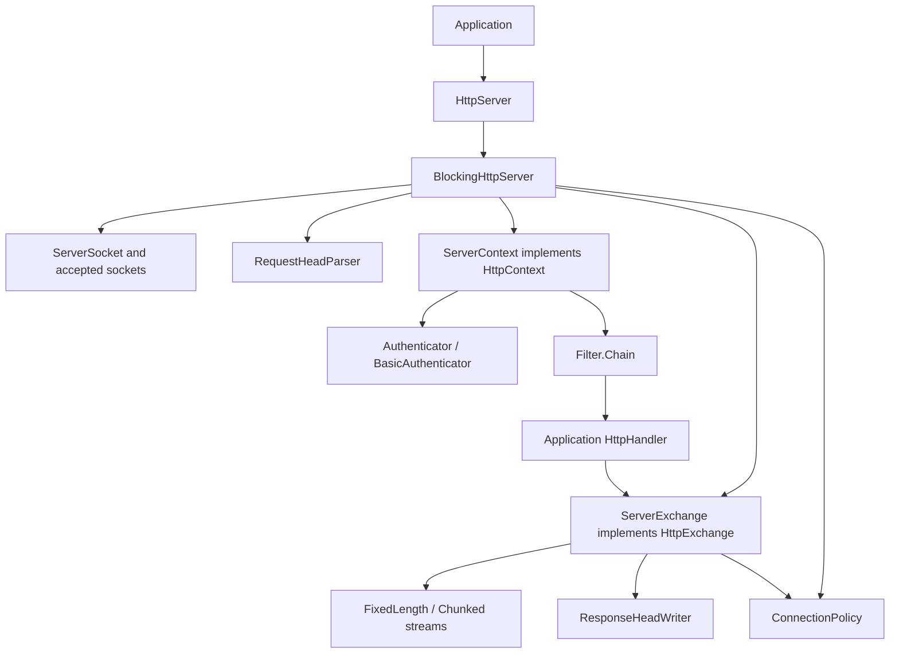
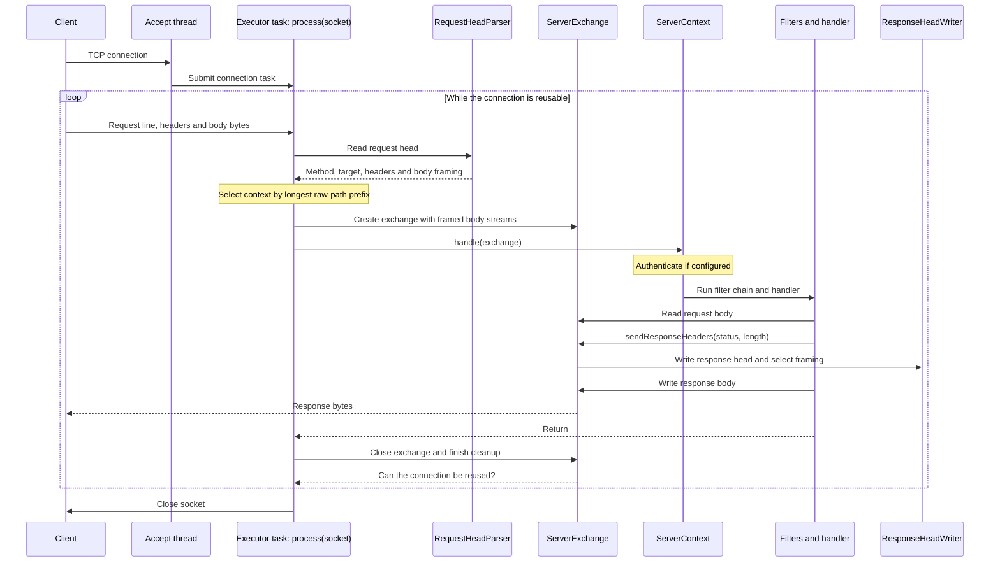
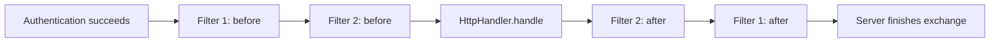
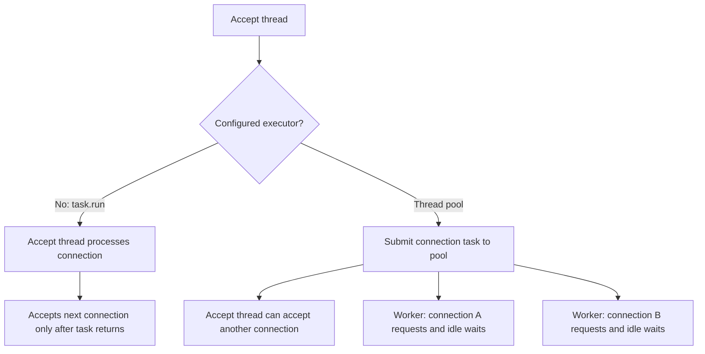

# How the HTTP server works

The server turns bytes on a TCP socket into an `HttpExchange`, passes that
exchange through authentication and filters to your handler, then writes an HTTP
response back to the socket. A connection can carry several exchanges, processed
one after another.

This describes the implementation in this repository. It uses blocking sockets
and supports HTTP/1.0 and HTTP/1.1. See [compatibility and limits](COMPATIBILITY.md)
for the supported behavior and exclusions.

## The main pieces

The public classes in `com.sun.net.httpserver` are the API applications use.
The classes in `internal` implement socket handling, parsing and serialization.

| Class | What it takes care of |
| --- | --- |
| `HttpServer` / `BlockingHttpServer` | The server lifecycle, listening socket, accepted connections, routing and dispatch to an executor. `HttpServer.create()` creates a `BlockingHttpServer`. |
| `HttpContext` / `ServerContext` | A registered path prefix with its handler, authenticator, filters and shared attributes. |
| `HttpExchange` / `ServerExchange` | One request and response: headers, body streams, addresses, principal, response state and cleanup. |
| `HttpHandler` | Application code that reads the request and produces the response. |
| `Authenticator`, `BasicAuthenticator`, `HttpPrincipal` | Authentication and the identity attached to a successful exchange. Applications supply the credential check for Basic authentication. |
| `Filter`, `Filter.Chain` | Processing around the handler, such as logging or stream wrapping. |
| `Headers`, `ReadOnlyHeaders` | Header storage. Request headers are read-only; response headers can be changed before they are sent. |
| `RequestHeadParser` | Reads and validates the request line and headers, then determines request body framing. |
| `ResponseHeadWriter` | Validates and serializes response headers and selects response body framing. |
| `FixedLengthInputStream`, `ChunkedInputStream` | Expose request body bytes without consuming the next request on the connection. |
| `FixedLengthOutputStream`, `ChunkedOutputStream` | Enforce an exact response length or encode a chunked response. |
| `ConnectionPolicy` | Connection persistence rules and the limits for idle reads and draining unread bodies. |
| `HttpSyntax` | Shared HTTP token and field-value checks used by parsing and serialization. |

## From an accepted connection to a response

`bind()` creates the listening socket. `start()` launches the server-owned
`httpserver-accept` thread, which accepts sockets and submits a runnable to the
configured executor. That runnable calls `process(socket)`.

`process` creates buffered input and output streams once for the connection.
It then repeatedly calls `processExchange` while the connection remains reusable.

The arrows show the logical call flow. With the default executor, the connection
task runs directly on the accept thread. With a thread pool, it runs on a worker.
Request bodies are read on demand; parsing the request head does not read the
whole body into memory.

Routing uses the longest case-sensitive prefix of the raw path. For example,
`/api/users` wins over `/api` for `/api/users/42`. Prefix matching is literal:
`/api` also matches `/apix`, and percent-encoded paths are not decoded for routing.

`OPTIONS *` is handled before resource routing: it asks about the server as a
whole, so the server returns an empty 200 response and closes the connection
without invoking a context's handler.

## Authentication, filters and the handler

`ServerContext` checks that it has a handler, then runs its authenticator if one
is configured. A successful result attaches an `HttpPrincipal` to the exchange.
A failure or retry sends the authenticator's response status and skips filters
and the handler. `BasicAuthenticator` also prepares a challenge when needed.

After authentication, the context takes a snapshot of its filters and creates a
fresh `Filter.Chain` for this exchange. Each filter chooses whether to call the
next link. A filter can return its own response without reaching the handler.

The “after” portions are code following `chain.doFilter(exchange)`, so they run
as calls return normally. A filter that needs cleanup even when downstream code
throws must use `finally`.

Filters can replace the streams exposed to application code through
`exchange.setStreams(...)`. `ServerExchange` still owns the underlying HTTP
framing and performs final cleanup when the handler returns.

## Where body handling fits

HTTP needs a way to tell where a body ends, particularly when another request
will follow on the same socket. That is the job of the framing streams.

On input, `RequestHeadParser` selects no body, a fixed `Content-Length`, or
chunked encoding. `ServerExchange` builds the corresponding input stream.
`ChunkedInputStream` removes chunk framing and validates trailers, which it
discards. The handler sees the decoded body bytes.

On output, `sendResponseHeaders(code, length)` asks `ResponseHeadWriter` to
choose framing and write the status line and headers. `ServerExchange` then
creates the matching output stream. A positive length means an exact byte count;
zero normally means chunked output on HTTP/1.1 or connection-delimited output on
HTTP/1.0; a negative length means no response body. HEAD and bodyless status
rules override the normal choice.

For `Expect: 100-continue`, the interim response is sent lazily when application
code first attempts to consume the body. This lets authentication or a handler
reject a request before asking the client to send its body.

## Threads and persistent connections

The unit submitted to the executor is **one connection**, including all of its
requests and the waits between them. Requests on that connection always run
sequentially, so pipelined responses retain their order.

The default is intentionally minimal: `execute(task)` calls `task.run()`.
A slow or idle connection can therefore hold up the accept loop. A supplied
executor determines concurrency; a synchronous executor still runs inline,
whereas a pool allows connections to be processed concurrently.

Even with a pool, an idle keep-alive connection occupies a worker. Each request
head gets an absolute deadline when its worker starts reading it, including the
idle wait on persistent connections. A stream wrapper checks monotonic elapsed
time on every parser read, including buffered bytes, and adjusts the socket read
timeout to the remaining budget. Progress does not renew the deadline. Expiry
closes the connection without attempting a potentially blocking error response.
After parsing, the socket timeout is cleared for application body reads. The
duration is snapshotted at server construction; configuration and defaults are
in [Compatibility](COMPATIBILITY.md#protocol-and-security-limits).
The server never shuts down a caller-supplied executor; its lifecycle belongs to
the application.

### Why there is no minimum header ingress rate

The absolute deadline bounds the time a worker spends waiting for a request head,
even when bytes keep arriving. A minimum ingress rate could reject some clients
earlier, but would also reject slow or bursty valid traffic that finishes within
the deadline. The current policy accepts that traffic. There are no deployment
traffic measurements here to justify a universal rate or grace period.

[OWASP's guidance](https://cheatsheetseries.owasp.org/cheatsheets/Denial_of_Service_Cheat_Sheet.html#rate-limiting)
calls for measuring genuine traffic when choosing a minimum rate.
[Apache's controls](https://httpd.apache.org/docs/2.4/mod/mod_reqtimeout.html)
combine an initial time allowance with byte-based extensions and an optional
maximum duration; their defaults do not establish suitable values for this server.
If deployment evidence calls for earlier rejection, a minimum rate can be
evaluated alongside admission limits. The header deadline alone does not limit
connection arrivals, queued work or body/write stalls.

## Finishing an exchange and stopping the server

After the handler returns, the server supplies a 500 response if the handler
has neither sent response headers nor closed the exchange. It then closes the
exchange, which finishes the response framing and handles unread request data.

Closing an exchange does not necessarily close its socket. Reuse requires a
complete request body, a finished response and compatible connection policy.
If the handler leaves body bytes unread, cleanup attempts to drain them within
64 KiB of wire bytes and a one-second total deadline. Failure makes the
connection non-reusable, preventing leftover body bytes from being mistaken
for the next request.

Malformed request heads receive the parser's error status and close the
connection. Protocol errors during exchange processing can produce 400, while
other handler failures can produce 500 if no response has started. Once a
response is committed, an error may require aborting the connection instead of
sending another response.

`BlockingHttpServer` tracks accepted sockets separately from sockets currently
running an exchange. `stop(delay)` closes the listener and idle connections,
allows active handlers up to the requested delay, then closes the remaining
sockets. It interrupts and joins its owned accept thread with a bounded cleanup
wait. Caller-owned workers are not interrupted, and an uncooperative handler
can outlive shutdown cleanup. Stopping is terminal: the server cannot restart.
